<p align="center">
  
</p>

<p align="center">
  <picture>
    <source media="(prefers-color-scheme: dark)" srcset="src/renderer/src/assets/wordmark-light.png">
    
  </picture>
</p>

<p align="center"><a href="https://github.com/ashdenlilley/Prometheus/actions/workflows/ci.yml"></a></p>

Local-first project management for a single user, on macOS and Windows. Linear-style issues, cycles, triage and roadmap. Monday-style boards with typed custom columns and dashboards. Optional encrypted folder sync across your own devices (see docs/sync.md).

## Views

- **Issues**: list grouped by any field, sorting, bulk edit.
- **Triage**: inbox to accept or decline incoming issues, with triage rules.
- **Board**: kanban grouped by any field, drag between columns, WIP limits when grouped by status.
- **Table**: monday-style table, inline edit, typed custom columns including formula, mirror and connect-boards, sub-issue rows, footer summaries, CSV import and export.
- **Timeline**: Gantt bars with dependency arrows from `blocks` relations, cycle bands, today marker.
- **Cycles**: time-boxed sprints with progress, burndown and velocity, roll-over of unfinished work.
- **Chart**: bar chart of issue counts or estimate points by any field.
- **Calendar**: issues on a month calendar by date.
- **Roadmap**: projects and initiatives as bars with progress, quarter/month/week zoom.
- **Dashboard**: widgets for numbers, progress, chart, list, workload, overdue, milestones and cycle.

## Also

- Teams: several projects can share one key, issue sequence, workflow and cycle settings.
- Markdown docs per space or project, with issue mentions, backlinks, a Doc column and doc templates.
- Sub-issues and relations (blocks, duplicate, related).
- Comments, @mention notifications and per-issue activity.
- Saved views with AND/OR filters.
- Issue templates.
- Automations triggered by status, priority, assignee or due-date.
- Command palette (Cmd/Ctrl+K).
- Local MCP server for coding agents such as Claude Code and Codex (streamable HTTP on 127.0.0.1, default port 7878, bearer token).
- Local REST API at `http://127.0.0.1:7878/api/v1` (the shared MCP token; per-agent tokens work on MCP only) and per-project outgoing webhooks signed with HMAC-SHA256, with retries and a delivery log. See [docs/api.md](docs/api.md).
- Agents as assignees: register agents in Settings > Agents, each with its own token (shown once, stored hashed) and a level (read, comment, write). Assign issues to an agent; it finds them with the `my_issues` MCP tool, and its changes are attributed to it in activity. Writes are rate limited to 60 a minute per agent.

For gaps compared with Linear and monday.com, see [docs/feature-parity.md](docs/feature-parity.md).

## Requirements

- Node 22 (pinned in `.nvmrc`; run `nvm use` if you use nvm).

To run the app (Electron 45):

- **macOS 13 (Ventura) or later**, Apple silicon (arm64) or Intel (x64). `npm run dist:mac` builds a DMG for both.
- **Windows 10 or later**, x64. `npm run dist:win` builds an NSIS installer. 32-bit (ia32) Windows is not supported.
- **Linux** is not a release target. For testing, `npx electron-builder --linux dir` builds an unpacked x64 app in `dist/linux-unpacked/`. 32-bit ARM (armv7l) is not supported.

## Run

```sh
npm install
npm run dev        # development
npm run typecheck
npm run test:sync   # sync integration tests
npm run build
npm run dist:mac   # .dmg (run on macOS)
npm run dist:win   # .exe installer (run on Windows)
```

## Data

Data is stored in a local SQLite database, `prometheus.db`, in the Electron `userData` directory. An older `prometheus-data.json` is imported once and renamed to `.bak`.

## CI and releases

- `.github/workflows/ci.yml` runs typecheck, sync tests and build on pull requests and pushes to `main`.
- Pushing a `v*` tag runs `.github/workflows/release.yml` to build the macOS DMG and Windows installer. See [docs/macos-package.md](docs/macos-package.md) and [docs/windows-package.md](docs/windows-package.md).
